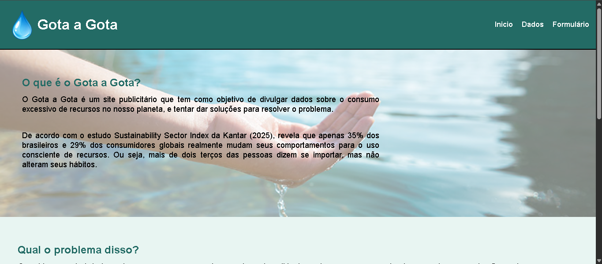
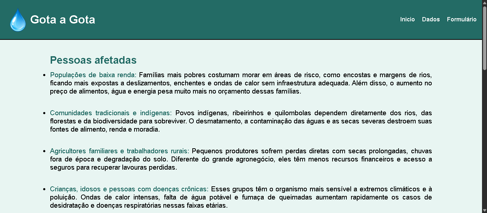
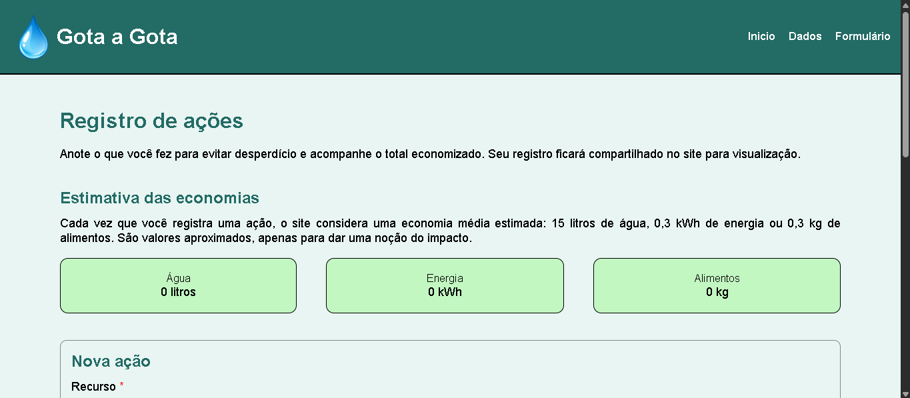

# Gota a Gota
> **P2** <
O site Gota a Gota tem o objetivo de demonstrar o impacto sobre o uso excessivo de recursos no planeta Terra, tentando influenciar a mais pessoas para uso consciente de recursos, redução do desperdício de água, energia e alimentos em casas, comunidades e pequenos negócios.

## Problemas
O problema central do tema "Uso consciente de recursos" é que o consumo excessivo e o descarte evitável esgotam os recursos naturais, aumentam os custos financeiros e agravam a desigualdade social e ambiental. Mesmo em pequena escala, o acúmulo de hábitos ineficientes gera impactos severos para toda a sociedade. Famílias de baixa renda, moradores de comunidades e pequenos comerciantes que dependem de água, energia e alimentos para suas atividades diárias, são as pessoas que acabam sofrendo com essa causa.

## Tecnologias usadas
* **HTML**
* **CSS**
* **JavaScript**
* **Claude**

## Execução do site
link hospedado pelo github pages:
https://g-france.github.io/P2---Uso-Consciente-de-Recursos/

## Projeto estruturado em pastas
O projeto Gota a Gota tem os arquivos individuais fora de pastas:
* index.html;
* dados.html;
* formulario.html;
* style.css;
* form.js;
* README.md.

Dentro da pasta **IMG**:
* email.png;
* facebook.png;
* Gota d'água.png;
* img_fundo.jpg;
* insta.png;
* tel.png;
* Print_página_inicio;
* Print_página_dados;
* Print_página_formulário.

## Prints das 3 telas do site
### Página inicial

### Página dados

### Página formulário
